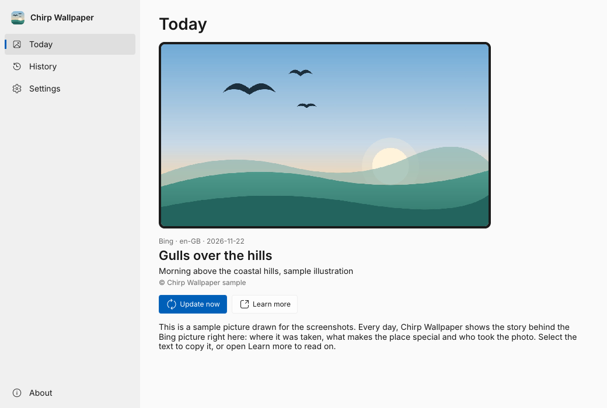
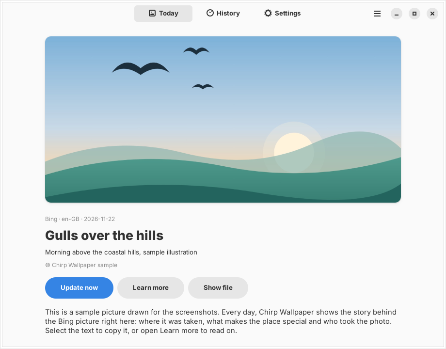

<p align="center"></p>

# Chirp Wallpaper

The daily Bing picture as desktop background **and** lock screen, for Windows 10/11 and GNOME.
Free, open source (MIT), one small program: no installation, no account, no administrator rights.

* **4K**: downloads the largest version Bing offers (usually 3840×2160), falls back to 1920×1080.
* **The story behind the picture**: title, place, copyright, a short text, “Learn more” link, text to copy.
* **21 languages**, picked from the system language (English otherwise). Pictures and texts follow your Bing region.
* **Offline-safe**: if no new picture can be loaded, nothing on screen changes; the app says why.
* **For all users of a computer**: one click sets up the lock and sign-in screen and the app for every account.

> Chirp Wallpaper is not affiliated with Microsoft. Pictures and texts come from Bing and belong to their photographers.

## Download

| | File |
|---|---|
| **Windows app** | [ChirpWallpaper.exe](https://github.com/wi-wissen/chirp-wallpaper/releases/latest/download/ChirpWallpaper.exe) |
| Windows command line | [chirp-windows-x64.exe](https://github.com/wi-wissen/chirp-wallpaper/releases/latest/download/chirp-windows-x64.exe) |
| **Linux app (GNOME), Flatpak** | [ChirpWallpaper.flatpak](https://github.com/wi-wissen/chirp-wallpaper/releases/latest/download/ChirpWallpaper.flatpak) |
| Linux command line | [chirp-linux-x86_64.tar.gz](https://github.com/wi-wissen/chirp-wallpaper/releases/latest/download/chirp-linux-x86_64.tar.gz) |

## Windows app



Download `ChirpWallpaper.exe`, put it anywhere (e.g. a `Programs` folder in your profile) and double-click it.

* **Today**: the picture and its story (select the text to copy it), *Update now*, *Learn more*.
* **History**: pictures of the last days; *Open* shows one in your picture viewer, *Use* sets it until the next picture of the day appears.
* **Settings**: start automatically, desktop and/or lock screen, picture region, 4K or Full HD, pause,
  fit (fill, fit, stretch, center, span), all screens or the main screen only, title and place written into the picture
  (corner of your choice; the copyright stays in the app), keep a copy of every picture in `Pictures\Chirp Wallpaper`.
* **Notification area**: open, *Learn more* about today's picture, update now, quit.
* **Remove stored data** (Settings → Data): deletes pictures, history, settings and autostart of this app for your
  account and quits. *Remove setup for all users* undoes the setup below (administrator rights).
* **When it checks**: at start, when a new day begins, after the computer wakes from sleep, and otherwise every hour.
  An automatic check only changes the background when a new picture of the day appears.
* **Set up for all users** (needs administrator rights, asks via UAC): see below.

**Starting with Windows:** turn on *Start automatically at sign-in* in the settings. The app then starts hidden
(`--background`), lives in the notification area and checks for a new picture at start and every hour.
A click on the tray icon opens the window; closing the window keeps it running in the tray; *Quit* is in the tray menu.
No shortcut in the Startup folder is needed (one would open the window at every sign-in).
Starting the app a second time just brings the open window to the front.

## Set up for all users

On shared computers, choose **Settings → Set up for all users** once (administrator rights needed). This

1. copies the app to `C:\Program Files\Chirp Wallpaper`,
2. stores the region and resolution for the whole computer,
3. adds a start-up task (and an hourly one) running as SYSTEM: it downloads the picture into
   `%ProgramData%\ChirpWallpaper` and sets the lock screen for everyone, also before sign-in (`PersonalizationCSP`),
4. starts the app hidden at every sign-in of every account, also new ones (nobody has to switch it on),
   which sets that user's desktop from the shared download.

Without internet nothing changes: the picture already on the computer stays. Accounts that never had a picture,
e.g. new ones, get the computer's latest picture instead of the Windows default. The app tells which picture is
shown and why.

Network access needed: `www.bing.com` only.

## Command line

The command line program does the same for scripts and admins:

```
chirp apply        # load today's picture and set it
chirp status       # what is on screen, the story behind it, last result
chirp install      # change automatically at sign-in and every hour
chirp uninstall
chirp config --market de-DE --resolution uhd --lockscreen on
chirp config --pause-until 2026-12-24
chirp config --resume
```

For all users (as administrator): add `--machine`, and `chirp seal --machine` keeps the current picture
as baseline (`--image school.jpg --title "Our school"` for your own). `--lang de` overrides the language.
Exit code `2` means "no new picture, nothing changed". A `chirp.toml` next to the program enables portable mode.

## Where things are

| | Windows | Linux |
|---|---|---|
| User settings | `%APPDATA%\chirp-wallpaper\config.toml` | `~/.config/chirp-wallpaper/config.toml` |
| User pictures | `%LOCALAPPDATA%\chirp-wallpaper` | `~/.local/share/chirp-wallpaper` |
| Machine settings and pictures | `%ProgramData%\ChirpWallpaper` | `/etc/chirp-wallpaper`, `/var/lib/chirp-wallpaper` |

Settings are merged: defaults → machine → portable → user.

## GNOME app



Install `ChirpWallpaper.flatpak` (double-click on Fedora and most GNOME systems; on Ubuntu, Flatpak has to be
added first, see [flatpak/FLATHUB.md](flatpak/FLATHUB.md)).

The app follows GNOME conventions: a header bar with *Today*, *History* and *Settings*, a banner when no new
picture could be loaded, selectable description text. GNOME has no tray icons, so with *Start automatically at
sign-in* the app starts without a window (`--background`, XDG autostart), keeps running and checks every hour;
opening it from the app grid shows the window, closing the window keeps it in the background.

The desktop is set with `gsettings`; GNOME's lock screen shows the same picture blurred, so it follows automatically.
The login screen (GDM) has no supported setting and is left unchanged.
Inside the Flatpak, the background is set through the wallpaper portal and autostart through the background portal
(GNOME may ask once for permission); outside it, `gsettings` and an XDG autostart entry are used.

## Translations

Texts live in [`crates/chirp-native/locales`](crates/chirp-native/locales), one [Fluent](https://projectfluent.org) file per language.
English and German are reviewed; all other languages are first drafts and welcome corrections by native speakers.
A test checks that every language has every text.

## Project layout

| Crate | Purpose |
|---|---|
| `chirp-core` | Bing source, cache, configuration, state, offline and baseline logic |
| `chirp-native` | Windows and GNOME backends, autostart and tasks, translations |
| `chirp` | command line program |
| `chirp-app` | Windows app (Slint, Fluent style, tray icon) |
| `chirp-gnome` | GNOME app (GTK 4, libadwaita) |

```
cargo test
cargo build --release -p chirp-app -p chirp-gnome
scripts/ui-test.py          # start, offline start, offline with picture, layout matrix
scripts/ui-test.py --gnome
```

The UI scenarios use a local stand-in for Bing (`scripts/fake-bing.py`) and also run in CI.
Rules for contributors (and AI assistants) are in [CLAUDE.md](CLAUDE.md).

## Release

Actions → **Release** → *Run workflow*, enter a version like `0.2.0`. The workflow builds `main`, tags it and
publishes the files under fixed names, so the links above always point to the newest version.

## Licence

MIT, see [LICENSE](LICENSE). Clean-room implementation: no code from other wallpaper apps was used.
